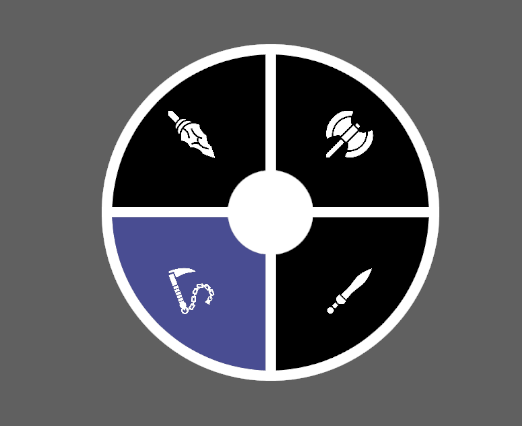
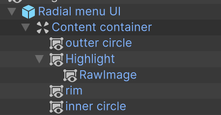
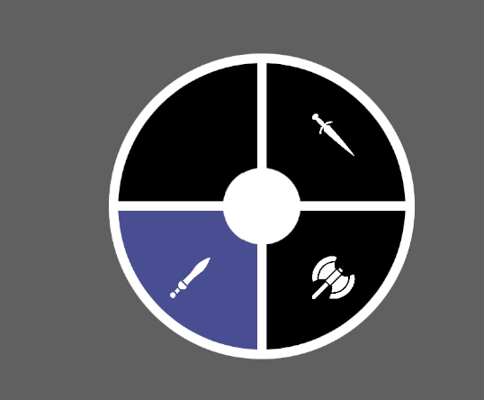
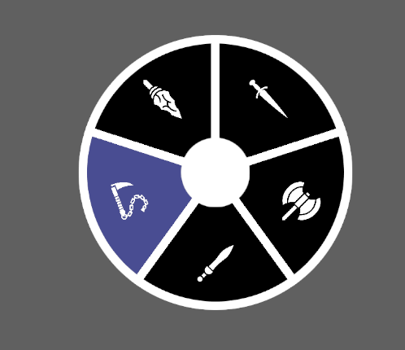
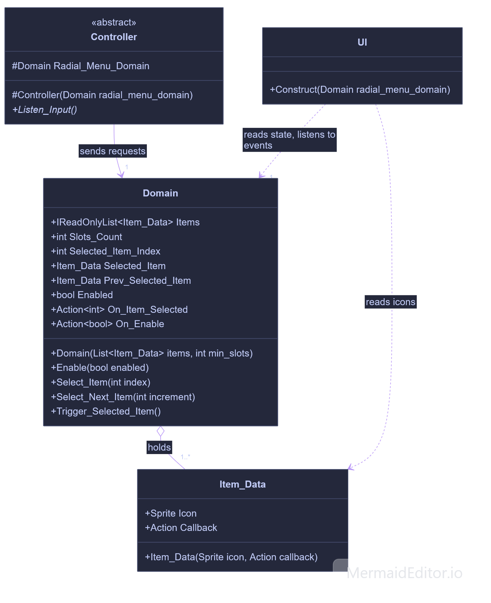
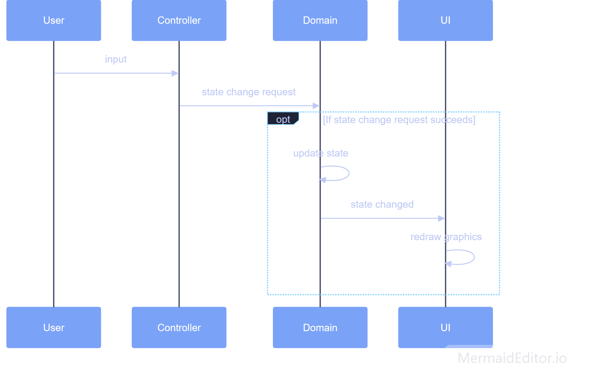

# Programmatic Radial Menu Unity Asset

v1.0.0

## Overview

A radial menu programmatically generated from data. Each of its items consists of an icon and a callback. The UI is made from UGUI, not UI Toolkit.

## Requirements

- Unity Editor. Minimum version: 2019.4. Tested only with: 6000.6.4f1.
- Unity's new Input System. Minimum version: 1.8.0. Tested only with: 1.20.0.

## Features

- Toggle the radial menu's visibility by pressing a button.
- Create items programmatically. Each item is made of an icon and a callback.
- Items can be selected by pointing at them or by cycling through them. This project comes with 3 selection modes, set up for mouse/keyboard and gamepad input:
  - Select by pointing and trigger immediately.
  - Select by pointing then trigger by pressing a button.
  - Select by cycling then trigger by pressing a button.
- A selected item is highlighted automatically in the UI.
- Layout consistency. You set the minimum number of slots, and the graphics show the empty ones.

## Setup

If you want to get started quickly, simply have a look at and reuse the complete implementation example inside the Sample folder.

Alternatively, if you want to set up the project from scratch, here are the steps to follow:

1. Install the Input System (_Window > Package Manager > Unity Registry > Input System_).
2. Go to Project Settings > Player > Other Settings > Active Input Handling and set it to Input System Package (New) or Both.
3. Copy or import the Core folder into your own project.
4. Create a scene and add a Canvas.
5. Drag and drop the radial menu UI prefab onto this Canvas.

   

6. Add a GameObject to the scene, and drag and drop the `Radial_Menu_Example` script onto it. Fill in the 3 serialized fields:
   1. `input_action_asset`: the asset is located inside your copy of the Core folder.
   2. `radial_menu_ui`: the instance is located in the Unity scene you created.
   3. `icons`: the assets are located inside your copy of the Core folder.
7. Press the Play button in the Editor and interact with the menu using your mouse and left-click.

## How it works

### Business rules

- The menu must have at least 1 slot and 1 item.
- When the menu is created, the first item is selected.
- There is always 1 item selected.
- Items fill the menu clockwise, starting from 12 o'clock.
- Items fit into slots. There is a minimum number of slots that you set. If there are more items than the minimum number of slots, the menu has 1 slot per item.

| 4 slots minimum, 3 items | 4 slots minimum, 4 items | 4 slots minimum, 5 items |
|:---:|:---:|:---:|
|  |  |  |

### Graphics

The menu is made of several elements: rim, outer circle, inner circle, lines, highlight and icons, all stored as .png files. They are located in Core > Radial Menu Graphics. These graphics are used by the radial menu UI prefab. Feel free to create your own graphics by following the same structure.

### Code

The code architecture is built around 3 elements: domain, controller and UI.

Requests to change the domain's state follow this sequence:

For example, selecting an item in the menu goes like this:

1. Input: the user moves the mouse. The controller picks up on it and determines the index of the item to be selected.
2. State change request: the controller asks the domain to select the item at the determined index.
3. State change request succeeds: the domain accepts the request, selects the item and updates its state. The UI reacts to the domain's state change and updates its graphics by highlighting the icon representing the selected item.

#### Domain Class

The domain owns and applies the business logic. Source: [`Domain.cs`](../Assets/Core/Scripts/Domain.cs).

#### Controller Class

The controller has 2 responsibilities. First, it listens for the player's input: pressing a button, moving the mouse. Second, it uses that input to ask the domain to change its state: selecting an item, for instance.

You can create your own ways of interacting with the menu by extending the `Controller` class. Source: [`Controller.cs`](../Assets/Core/Scripts/Controller.cs).

I created 3 examples you can refer to:

- `Controller_Point_Select_And_Trigger`: select an item by pointing at it and trigger it immediately. Source: [`Controller_Point_Select_And_Trigger.cs`](../Assets/Core/Scripts/Controller_Point_Select_And_Trigger.cs).
- `Controller_Point_Select_Then_Trigger`: select an item by pointing at it, then trigger it with a different button. Source: [`Controller_Point_Select_Then_Trigger.cs`](../Assets/Core/Scripts/Controller_Point_Select_Then_Trigger.cs).
- `Controller_Cycle_Select_Then_Trigger`: select an item by cycling through all the items, then trigger it with a different button. Source: [`Controller_Cycle_Select_Then_Trigger.cs`](../Assets/Core/Scripts/Controller_Cycle_Select_Then_Trigger.cs).

#### UI Class

The UI class reacts to changes in the domain's state by updating its graphics. A selected item in the domain will result in its associated icon being highlighted in the UI.Source: [`UI.cs`](../Assets/Core/Scripts/UI/UI.cs).

## Limitations

To limit the scope of this project and keep it simple, I chose to apply some constraints:

- Once a radial menu is built, it cannot be altered, i.e., items cannot be added or removed. You will need to destroy and rebuild the whole system.
- There are 3 selection modes, but you can add more by extending the current code.
- The `InputActionAsset` that comes with the project is set up for mouse/keyboard and gamepad, but you can add your own input actions for other input methods, such as touch for mobile.
